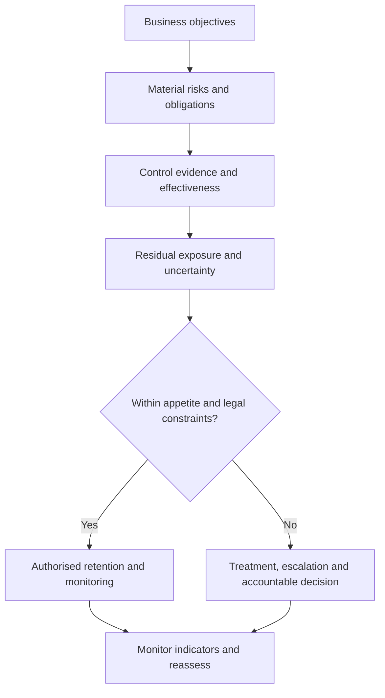

<div align="center">

<sub><strong>ELITE GRC MASTERY</strong> · EXECUTIVE LEARNING SERIES</sub>

# GRC Executive Foundations

**MODULE 001 / 060**

*Strategy-first governance · Evidence-based assurance · Accountable risk decisions*

**[Explore the summary](#executive-summary)** · **[Test your judgement](#knowledge-assessment)** · **[Practise executive interviews](#executive-interviews)**

</div>

---

> [!IMPORTANT]
> **The executive principle:** GRC exists to improve accountable business decisions—not merely to produce policies, compliance reports or dashboards.

<table>
  <tr>
    <th align="left">Your learning path</th>
    <th align="left">What you will practise</th>
  </tr>
  <tr>
    <td><strong>01 · Understand</strong></td>
    <td>Five core principles, language and governance roles</td>
  </tr>
  <tr>
    <td><strong>02 · Apply</strong></td>
    <td>Common failure patterns, an executive decision model and GRC maturity</td>
  </tr>
  <tr>
    <td><strong>03 · Evaluate</strong></td>
    <td>10 progressively harder multiple-choice scenarios</td>
  </tr>
  <tr>
    <td><strong>04 · Defend</strong></td>
    <td>Two senior-level interview cases requiring evidence and judgement</td>
  </tr>
</table>

### Navigate this module

| Learn | Practise | Finish |
|:--|:--|:--|
| [Executive summary](#executive-summary) | [QCM assessment](#knowledge-assessment) | [Answer worksheet](#answer-worksheet) |
| [Essential terminology](#essential-terminology) | [Questions 01–05](#q01) | [Interview case 01](#interview-case-01) |
| [Executive practice](#common-failures-versus-executive-practice) | [Questions 06–10](#q06) | [Interview case 02](#interview-case-02) |
| [GRC maturity](#the-maturity-journey) | [Assessment rules](#assessment-protocol) | [Completion checklist](#completion-checklist) |

---

<a id="executive-summary"></a>
## 01. Executive summary

### Five key takeaways

1. **GRC enables strategy.** Its purpose is better accountable decision-making, not simply regulatory reporting.
2. **Accountability matters.** The people advising on risk, managing it, approving it and independently assuring it may have different responsibilities.
3. **Risk is business uncertainty.** Cyber incidents matter because they can affect customers, revenue, safety, reputation, legal obligations and resilience.
4. **Evidence determines confidence.** Control documentation, implementation, operating effectiveness and independent assurance are distinct.
5. **Residual risk drives decisions.** Prioritisation should reflect actual exposure, risk appetite, legal constraints, remediation value and decision authority.

> [!TIP]
> **Use this decision lens:** What are we trying to achieve? What could materially prevent it? What evidence supports our assessment? What must be done, by whom, and with whose authority?

### An executive GRC decision model



*Learning model: a decision sequence, not a substitute for an organisation's formal governance framework.*

<a id="essential-terminology"></a>
### Essential terminology

| Term | Remember |
|:--|:--|
| **Accountability** | Who is ultimately answerable for an outcome or decision |
| **Risk owner** | Who has responsibility and authority for managing a particular risk |
| **Control owner** | Who operates and maintains a specific control |
| **KPI** | Performance or outcome indicator |
| **KRI** | Indicator of risk exposure or emerging risk |
| **KCI** | Indicator of control operation or effectiveness |
| **Assurance** | Evidence-based evaluation that increases confidence in a conclusion |
| **Risk treatment** | Avoid, reduce, share/transfer certain consequences, or retain risk |
| **Risk acceptance** | Authorised decision to retain residual risk; not a substitute for compliance |

<a id="common-failures-versus-executive-practice"></a>
### Common failures versus executive practice

| Common mistake | Better GRC practice |
|:--|:--|
| Treating GRC as a checklist | Integrate GRC into business decisions |
| Confusing policies with effective controls | Examine implementation and performance |
| Assigning all risk to the CISO | Establish accountable business risk owners |
| Reporting only percentages | Explain exposure, significance and required decisions |
| Assuming certification means no material risk | Examine scope, exceptions and residual exposure |
| Letting internal audit own remediation | Preserve management responsibility and audit independence |

<a id="the-maturity-journey"></a>
### The maturity journey

| Stage | Maturity | What it looks like |
|:--:|:--|:--|
| **1** | Initial | Reactive, fragmented and largely informal |
| **2** | Developing | Basic structure, inconsistent application |
| **3** | Defined | Documented processes and established ownership |
| **4** | Managed | Measured performance, integrated oversight |
| **5** | Optimised | Adaptive, outcome-driven improvement |

<sub>This is an illustrative five-stage learning progression, not a certification claim or a universal scoring standard.</sub>

---

<a id="knowledge-assessment"></a>
## 02. Knowledge assessment

**10 challenging QCMs** · Progressive difficulty · **One best answer per question** · **No solutions revealed**

<a id="assessment-protocol"></a>
> [!NOTE]
> **How to use this assessment**
> 1. Open one question at a time.
> 2. Choose the *single most defensible* option, not merely an option that sounds plausible.
> 3. Record your answers in the [worksheet](#answer-worksheet).
> 4. For harder scenarios, add one sentence explaining your reasoning.
>
> This README supports clickable expand/collapse panels on GitHub. GitHub does **not** save selections or grade quiz answers inside a README.

<sub>**Difficulty progression:** Foundation → Practitioner → Manager → Senior Manager → Director → CISO</sub>

<a id="q01"></a>
<details>
<summary><strong>QUESTION 01 / 10</strong> · FOUNDATION · Governance authority</summary>

**A company has comprehensive cybersecurity policies, but security exceptions are routinely approved without defined authority or escalation. Which underlying GRC weakness is most significant?**

- **A.** Insufficient security awareness training
- **B.** Inadequate governance and accountability
- **C.** Absence of a formal internal audit charter
- **D.** Lack of a more sophisticated GRC software platform

</details>

<a id="q02"></a>
<details>
<summary><strong>QUESTION 02 / 10</strong> · FOUNDATION · Strategic integration</summary>

**A bank is expanding internationally and wants to integrate GRC into its growth strategy. Which approach best reflects GRC as an enterprise decision system?**

- **A.** Prioritise obtaining ISO certification before evaluating the expansion
- **B.** Allow cybersecurity teams to determine whether the business should expand
- **C.** Connect strategic objectives, material risks, applicable obligations and decision authority
- **D.** Maintain separate governance, risk and compliance processes to preserve independence

</details>

<a id="q03"></a>
<details>
<summary><strong>QUESTION 03 / 10</strong> · PRACTITIONER · Control evidence</summary>

**An auditor finds an approved access control policy and evidence that a privileged access management tool is configured. What conclusion is most defensible?**

- **A.** The control has demonstrated effective operation throughout the review period
- **B.** The control is effective because it has both administrative and technical components
- **C.** The associated access risk can be classified as acceptable
- **D.** Design and implementation may be supported, but operating effectiveness requires further evidence

</details>

<a id="q04"></a>
<details>
<summary><strong>QUESTION 04 / 10</strong> · PRACTITIONER · Business risk ownership</summary>

**A hospital identifies a material ransomware risk. The CISO proposes improvements, while the Chief Operating Officer is accountable for continuity of clinical services. Who should normally own the business risk of prolonged service interruption?**

- **A.** The Chief Operating Officer or appropriately designated accountable business executive
- **B.** The internal audit function because it provides independent assurance
- **C.** The external cybersecurity assessment provider
- **D.** The CISO automatically, because ransomware is a cybersecurity threat

</details>

<a id="q05"></a>
<details>
<summary><strong>QUESTION 05 / 10</strong> · MANAGER · Mandatory obligations</summary>

**An organisation reports that 95% of regulatory obligations are satisfied. One unmet obligation concerns a mandatory condition for operating a critical financial service. What is the strongest management response?**

- **A.** Accept the 5% deviation because overall compliance exceeds 90%
- **B.** Defer action until internal audit verifies the next reporting cycle
- **C.** Assess the material non-compliance immediately, prevent prohibited activity and escalate through the required channels
- **D.** Reclassify the outstanding requirement as a security risk so that the risk owner can accept it

</details>

<a id="q06"></a>
<details>
<summary><strong>QUESTION 06 / 10</strong> · MANAGER · Audit independence</summary>

**An internal audit team identifies ineffective privileged access controls. Management asks internal audit to design, operate and subsequently validate the replacement control. What is the principal concern?**

- **A.** Internal audit is not allowed to understand technical security controls
- **B.** This could compromise independent assurance by making audit responsible for the control it later evaluates
- **C.** Internal audit must always obtain the board's permission before discussing remediation
- **D.** The arrangement is acceptable whenever remediation is urgent

</details>

<a id="q07"></a>
<details>
<summary><strong>QUESTION 07 / 10</strong> · SENIOR MANAGER · Risk concentration</summary>

**A bank's dashboard shows 12 overdue high-risk findings. Several concern the same critical third-party platform, while the others concern low-exposure services. What should the GRC Director prioritise?**

- **A.** Prioritise the oldest findings irrespective of business impact
- **B.** Close easy findings first to improve the dashboard
- **C.** Escalate all 12 as identical risks because they share the same rating
- **D.** Analyse concentration, dependencies, control effectiveness, potential loss and risk appetite before prioritisation

</details>

<a id="q08"></a>
<details>
<summary><strong>QUESTION 08 / 10</strong> · DIRECTOR · Assurance coverage</summary>

**A security dashboard reports 90% critical control effectiveness. Further review reveals that only 30 of 80 in-scope controls were tested, and selection criteria were not documented. Which statement is best supported?**

- **A.** The reported percentage is insufficient to support an enterprise-wide effectiveness conclusion
- **B.** The organisation can claim that 90% of its cyber risk has been mitigated
- **C.** The result is reliable if the untested controls have approved policies
- **D.** The dashboard should simply reduce the enterprise risk score by 10%

</details>

<a id="q09"></a>
<details>
<summary><strong>QUESTION 09 / 10</strong> · DIRECTOR · Investment judgement</summary>

**A company can spend $600,000 on a comprehensive security improvement or $250,000 on a targeted option. Both reduce different portions of a material business risk, but estimates remain uncertain. What is the most mature recommendation?**

- **A.** Select the more expensive option because greater spending demonstrates stronger oversight
- **B.** Select the cheaper option because it offers the lowest immediate cost
- **C.** Compare credible scenarios, risk reduction, dependencies, residual exposure, appetite and total costs before recommending an option
- **D.** Delay investment until the exact probability of a cybersecurity incident is known

</details>

<a id="q10"></a>
<details>
<summary><strong>QUESTION 10 / 10</strong> · CISO · Critical launch decision</summary>

**A CEO requests immediate launch of a payment service despite incomplete critical control testing, potentially unmet regulatory conditions and an unverified third-party dependency. Revenue pressure is significant. What should the CISO do?**

- **A.** Permit launch with the CEO's verbal risk acceptance, then complete the missing tests
- **B.** Present evidence limitations, distinguish mandatory obligations from acceptably retainable risks, assess constrained alternatives and escalate a conditional recommendation through authorised governance
- **C.** Reject the project permanently because incomplete security testing always makes innovation unacceptable
- **D.** Transfer the launch decision to internal audit so that the CISO is no longer accountable for providing a risk recommendation

</details>

<a id="answer-worksheet"></a>
### Your assessment worksheet

<details>
<summary><strong>Open the copy-ready answer sheet</strong> · Complete it before asking for feedback</summary>

Copy this template into your notes, a GitHub discussion or your learning conversation:

```text
MODULE 001 — GRC EXECUTIVE FOUNDATIONS

Q01: [ ]    Q02: [ ]    Q03: [ ]    Q04: [ ]    Q05: [ ]
Q06: [ ]    Q07: [ ]    Q08: [ ]    Q09: [ ]    Q10: [ ]

Hardest question(s):
My reasoning:
What I would verify before making an executive decision:
```

**Allowed answers:** A, B, C or D. No answer key is included in this learner edition.

</details>

---

<a id="executive-interviews"></a>
## 03. Executive interview preparation

**Two case-based interviews** · Evidence-first assessment · Business risk judgement · Executive communication

The goal is to defend a credible recommendation, not recite definitions. Identify what is known, what remains uncertain, what requires a decision and who is authorised to make it.

<a id="interview-case-01"></a>
### Interview 01 — Senior GRC / Cybersecurity Manager

<details>
<summary><strong>Open case 01</strong> · Control effectiveness and audit judgement</summary>

You are leading an enterprise GRC assessment for a financial institution aligned with **NIST CSF 2.0**.

Management asserts that privileged access is effectively controlled because it has an approved access management policy, a deployed PAM solution, quarterly access reviews and a previous audit report containing no major findings.

**During your assessment, you discover that:**

- Several service accounts are absent from the PAM inventory.
- Quarterly reviews are completed, but there is limited evidence that identified exceptions are resolved.
- The PAM implementation covers only part of the production environment.
- Management continues to report the control as fully effective.

**YOUR INTERVIEW ANSWER — QUESTION 1**

Explain how you would assess **control design, implementation and operating effectiveness**; challenge management's assertions; evaluate the associated business risk; document your findings; and recommend proportionate remediation.

Also explain **which evidence you would request** and **how you would communicate your conclusion to the CIO and CISO**.

</details>

**What this tests:** evidence quality · scope and population coverage · professional scepticism · risk translation · executive communication

<a id="interview-case-02"></a>
### Interview 02 — CISO / GRC Director

<details>
<summary><strong>Open case 02</strong> · Board-level prioritisation and risk appetite</summary>

You have recently been appointed CISO of a large international financial services company.

The board has approved a cybersecurity improvement budget of **$2 million**, but your initial assessment identifies three competing priorities.

*All amounts and risk estimates are hypothetical.*

| Investment proposal | Estimated cost | Key concern |
|:--|--:|:--|
| Identity and privileged access improvement | **$1.2M** | High exposure across critical banking platforms |
| Operational resilience and recovery improvement | **$1.0M** | Inadequate demonstrated recovery capability |
| Regulatory compliance remediation | **$0.8M** | Material potential breaches; applicability and deadlines require confirmation |
| **Combined** | **$3.0M** | **$1.0M over the available budget** |

The CEO wants immediate digital expansion. The CFO refuses to increase the current budget without a stronger business case. The Risk Committee wants assurance that exposures will remain within risk appetite.

**YOUR INTERVIEW ANSWER — QUESTION 2**

As CISO, explain how you would **prioritise the investments**, address potential **mandatory regulatory obligations**, evaluate **residual risks** and present a defensible recommendation to the **CEO, CFO and board**.

You must explain **how you would handle uncertainty, justify your choices and establish accountability** for what remains unresolved.

</details>

**What this tests:** capital allocation · regulatory constraints · risk appetite · uncertainty · board-level judgement

### Structure your response

Use this as a **presentation framework**, not an answer key:

| Step | Executive question |
|:--|:--|
| **1 · Context** | Which business objective and material exposure are at stake? |
| **2 · Evidence** | What can we substantiate, and where is confidence limited? |
| **3 · Options** | Which defensible courses of action exist, including constraints and trade-offs? |
| **4 · Decision** | What do you recommend, and which authority must decide? |
| **5 · Follow-through** | Who owns remediation, reporting and reassessment? |

---

<a id="completion-checklist"></a>
## 04. Completion checklist

Use these as a self-review when working through the module. On GitHub, edit the Markdown source to mark an item complete; a rendered README does not persist checkbox changes.

- [ ] I can explain why GRC serves business strategy rather than only compliance.
- [ ] I can distinguish business risk owners, control owners, advisers and independent assurance.
- [ ] I can separate control documentation, implementation and operating effectiveness.
- [ ] I can explain residual risk, legal constraints and authorised risk acceptance.
- [ ] I have attempted all 10 QCMs without an answer key.
- [ ] I have prepared both interview responses with evidence, decision rationale and accountability.

> [!IMPORTANT]
> **Mastery standard:** Do not report a conclusion more confidently than the evidence supports. State uncertainty, translate it into business exposure, and identify the decision owner.

<div align="center">

---

**MODULE 001 / 060 · GRC EXECUTIVE FOUNDATIONS**

[Back to top](#grc-executive-foundations) · [Assessment](#knowledge-assessment) · [Interviews](#executive-interviews)

<sub>Self-study resource · Assessment solutions intentionally withheld</sub>

</div>
